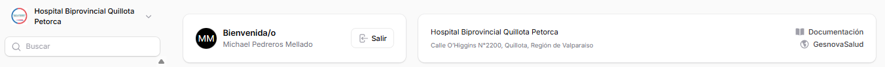
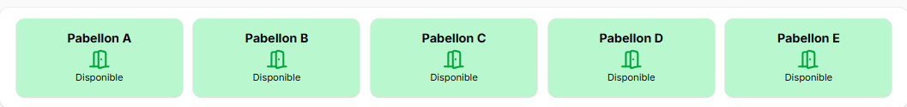
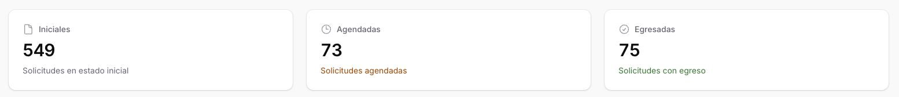
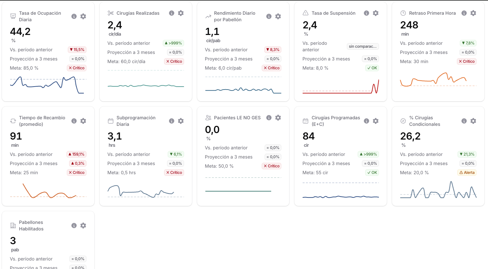
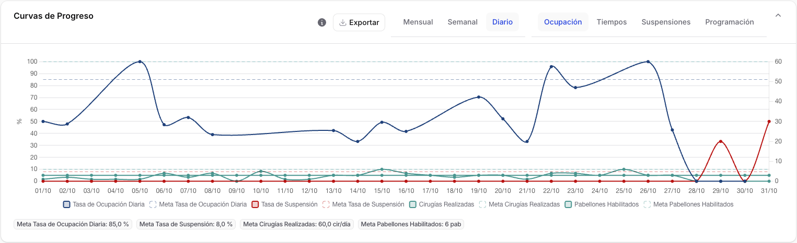
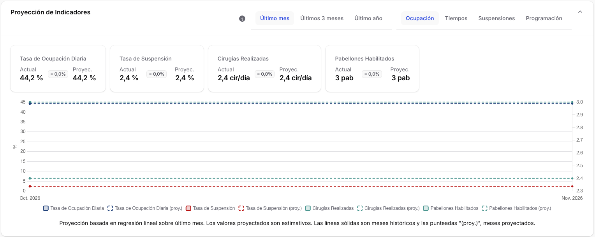

# Escritorio

## Descripción General
El Escritorio es la página principal de la aplicación. Al ingresar, muestra un resumen completo del estado de las solicitudes del hospital y proporciona acceso rápido a la documentación y otros recursos.

## Sección de Usuario
En la parte superior izquierda se muestra:
- **Mensaje de bienvenida**: "Bienvenida/o" seguido del nombre del usuario
- **Avatar**: Círculo con las iniciales del usuario
- **Nombre completo**: Nombre y apellidos del usuario que ha iniciado sesión

## Información del Hospital
En la parte superior central se presenta:
- **Nombre del hospital**: Hospital Biprovincial Quillota Petorca
- **Botón Salir**: Permite cerrar sesión
- **Dirección**: Calle O´Higgins -N°2200, Quillota, Región de Valparaíso
- **Enlaces rápidos**:
  - **Documentación**: Acceso a la documentación del sistema
  - **GesnovaSalud**: Enlace al sitio principal de GesnovaSalud

## Barra Superior del Escritorio
En la esquina superior derecha del Escritorio se encuentran dos botones:
- **Filtros**: Permite definir el rango de fechas y otros criterios con los que se calculan los indicadores.
- **Actualizar datos**: Recarga la información mostrada en el Escritorio.

## Disponibilidad de Pabellones
En Escritorio, también existe la posibilidad de visualizar la disponibilidad de los pabellones del hospital. Cada tarjeta indica:
- **Nombre del pabellón**
- **Estado**: Disponible, o bloqueado por aseo u otro motivo. Las tarjetas disponibles se muestran en verde.
- **Enviar mensaje**: Enlace para enviar un mensaje relacionado con ese pabellón.

## Dashboard de Solicitudes
El escritorio muestra tres tarjetas con estadísticas en tiempo real sobre el estado de las solicitudes:

### Iniciales
- **Contador**: Número de solicitudes en estado inicial
- **Descripción**: Solicitudes en estado inicial

### Agendadas
- **Contador**: Número de solicitudes agendadas
- **Descripción**: Solicitudes agendadas (texto en color naranja)

### Egresadas
- **Contador**: Número de solicitudes con egreso
- **Descripción**: Solicitudes con egreso (texto en color verde)

Estas tarjetas permiten identificar rápidamente:
- Cuántas solicitudes se encuentran en su estado inicial (Iniciales)
- Las solicitudes que ya cuentan con agenda (Agendadas)
- Las solicitudes que ya finalizaron con egreso (Egresadas)

## Indicadores Quirúrgicos
Esta sección muestra los indicadores de los pabellones de tipo electivo para el período filtrado. Cada tarjeta presenta:
- **Valor actual** del indicador y su unidad de medida
- **Vs. período anterior**: Variación porcentual respecto al período anterior equivalente. Si no hay datos para comparar, se muestra "sin comparación".
- **Proyección a 3 meses**: Variación porcentual estimada hacia donde va el indicador.
- **Meta**: Valor objetivo del indicador, con su estado: **OK**, **Alerta** o **Crítico**.
- **Gráfico de tendencia**: Línea de evolución del indicador con la meta como línea punteada.
- **Íconos de información y configuración**: Al pasar el cursor se muestra el detalle del indicador; el ícono de engranaje permite configurarlo.

Los indicadores disponibles son:
- **Tasa de Ocupación Diaria** (%)
- **Cirugías Realizadas** (cir/día)
- **Rendimiento Diario por Pabellón** (cir/pab)
- **Tasa de Suspensión** (%)
- **Retraso Primera Hora** (min)
- **Tiempo de Recambio (promedio)** (min)
- **Subprogramación Diaria** (hrs)
- **Pacientes LE NO GES** (%)
- **Cirugías Programadas (E+C)** (cir)
- **% Cirugías Condicionales** (%)
- **Pabellones Habilitados** (pab)

## Curvas de Progreso
Sección colapsable que grafica la evolución de los indicadores en el tiempo. Incluye:
- **Ícono de información**: Explica el funcionamiento del gráfico.
- **Exportar**: Descarga los datos del gráfico.
- **Periodicidad**: Mensual, Semanal o Diario.
- **Categoría**: Ocupación, Tiempos, Suspensiones o Programación.

Con datos suficientes, el gráfico muestra:
- **Eje izquierdo y derecho**: Cada eje usa una escala distinta según la unidad de los indicadores.
- **Eje horizontal**: Los días, semanas o meses del período filtrado, según la periodicidad elegida.
- **Líneas de indicadores**: Una línea sólida por indicador de la categoría seleccionada. En Ocupación: Tasa de Ocupación Diaria, Tasa de Suspensión, Cirugías Realizadas y Pabellones Habilitados.
- **Líneas de meta**: Una línea punteada por cada indicador que representa su meta.
- **Leyenda**: Permite identificar cada línea y sus metas.
- **Metas**: Bajo la leyenda se listan los valores de meta.

## Proyección de Indicadores
Sección colapsable que estima la evolución futura de los indicadores. Incluye:
- **Ícono de información**: Explica el funcionamiento de la proyección.
- **Horizonte**: Último mes, Últimos 3 meses o Último año.
- **Categoría**: Ocupación, Tiempos, Suspensiones o Programación.

Con datos suficientes, se muestra:
- **Tarjetas resumen**: Una por indicador de la categoría (en Ocupación: Tasa de Ocupación Diaria, Tasa de Suspensión, Cirugías Realizadas y Pabellones Habilitados). Cada una indica el valor **Actual**, el valor proyectado (**Proyec.**) y la variación porcentual entre ambos.
- **Gráfico de proyección**: Muestra los meses del horizonte (en el ejemplo, Oct. 2026 a Nov. 2026) con dos ejes de escala. Las líneas sólidas corresponden a meses históricos y las punteadas, identificadas como "(proy.)", a meses proyectados.
- **Leyenda**: Identifica cada indicador y su línea proyectada.
- **Nota metodológica**: La proyección se basa en regresión lineal sobre el horizonte elegido y los valores proyectados son estimativos.

