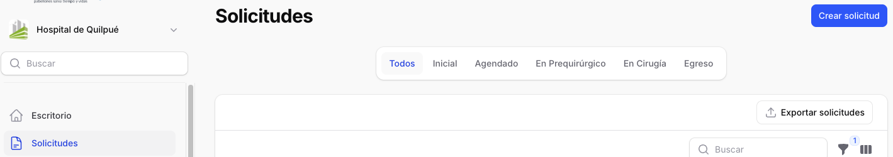
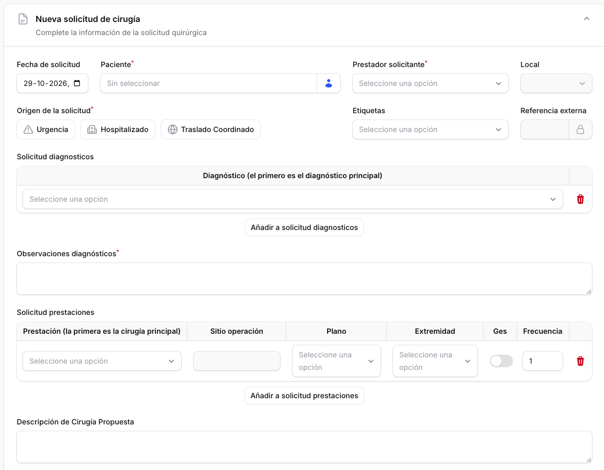
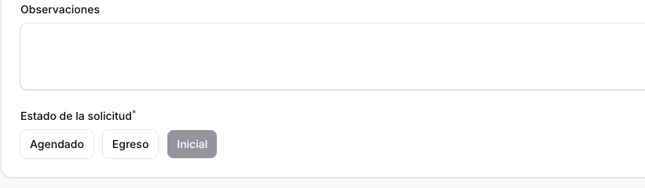
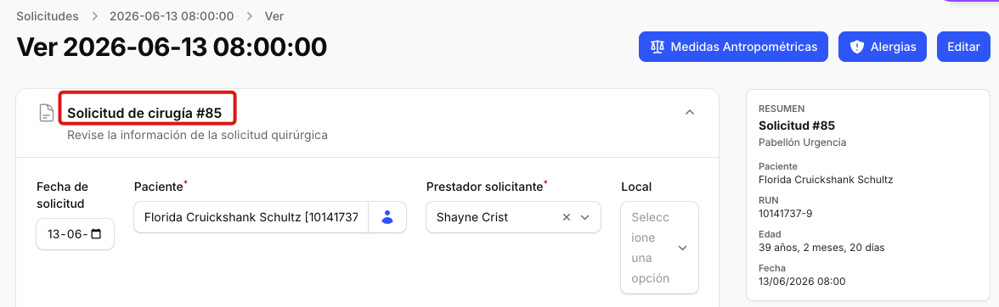
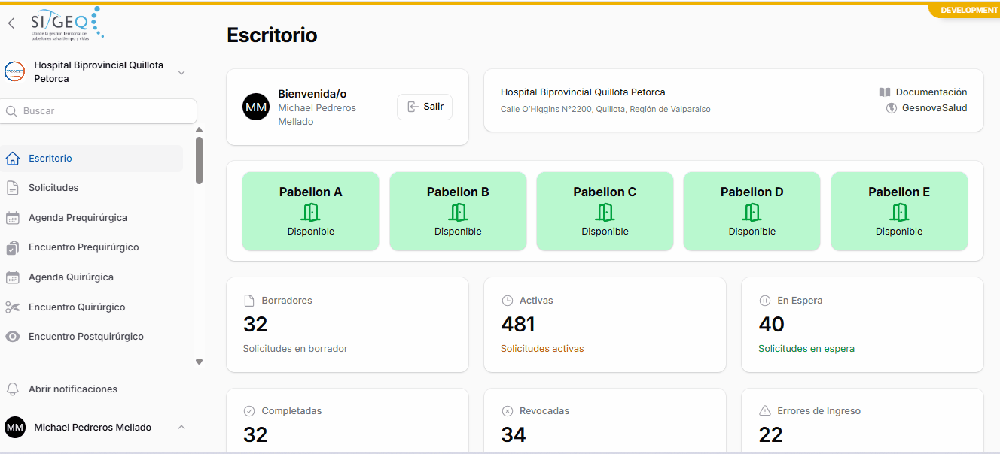
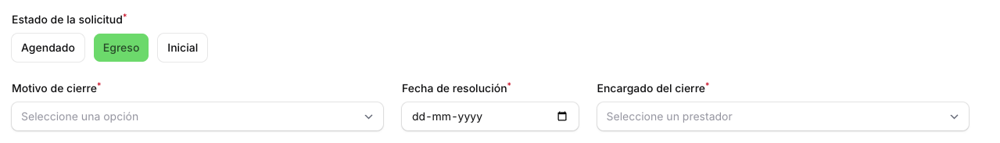

# Solicitudes
## Creación de nueva solicitud
Para crear una nueva solicitud, es necesario seleccionar dentro de menú "solicitudes" botón Crear solicitud.

Luego, en pantalla a continuación, se deberán completar los campos para generar solicitud. Los campos obligatorios del documento se identifican con un asterisco en la esquina superior de las opciones a completar.

El campo obligatorio "Estado de la solicitud" permite elegir entre **Agendado**, **Egreso** e **Inicial**. Una solicitud nueva se crea en estado "Inicial"; luego la misma solicitud puede ser editada para ir realizando gestión a la misma. Por último se debe presionar botón Crear.

Al presionar botón Crear, se generará un número de solicitud, el cuál será asignado a la creación realizada.

## Visualización de paso a paso

## Estado de la solicitud
Al momento de realizar gestión a las solicitudes emitidas, sistema permite cambiar de estado cada solicitud realizada, esto sirve de apoyo a la monitorización.

En el campo **Estado de la solicitud** (obligatorio, se identifica con asterisco), ubicado bajo el campo "Observaciones", se selecciona uno de los siguientes estados. El estado elegido se destaca con color:

- **Inicial**: Estado en el que queda la solicitud al ser creada, antes de su agendamiento. Se muestra en gris cuando está seleccionado.
- **Agendado**: La solicitud ya cuenta con agenda.
- **Egreso**: La solicitud ha finalizado. Se muestra en verde cuando está seleccionado. Al elegir este estado se despliegan tres campos obligatorios adicionales:
  - **Motivo de cierre**: Lista desplegable para seleccionar el motivo ("Seleccione una opción").
  - **Fecha de resolución**: Fecha en formato dd-mm-yyyy.
  - **Encargado del cierre**: Lista desplegable para seleccionar el prestador responsable ("Seleccione un prestador").

