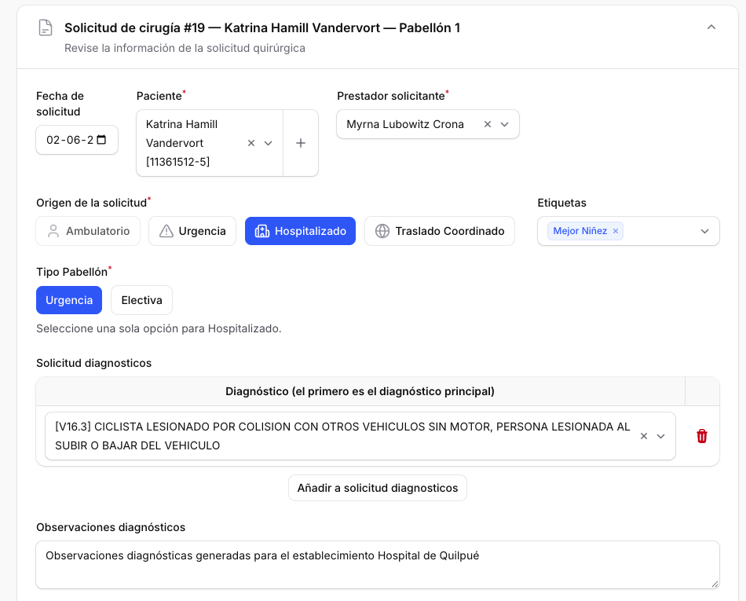
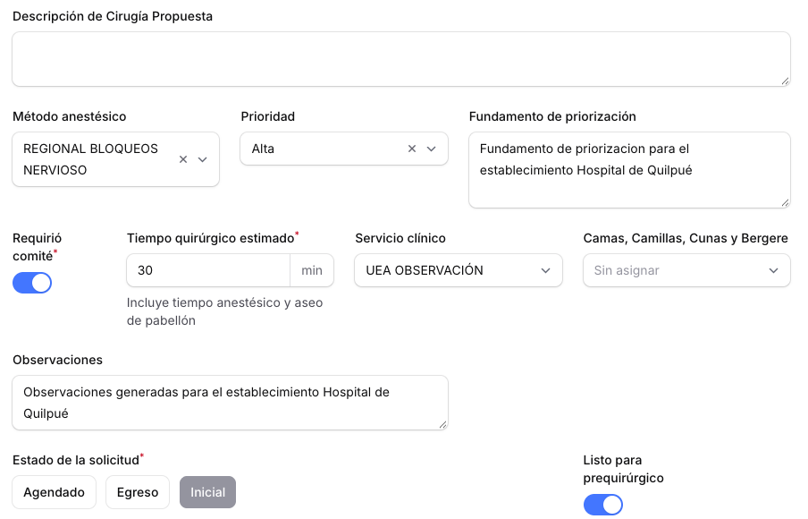

# Encuentro Prequirúrgico

## Descripción General
El Encuentro Prequirúrgico permite revisar y actualizar la solicitud quirúrgica, completar los datos del encuentro y acceder a los formularios asociados a la evaluación del paciente antes de la cirugía.

## Visualización previa de encuentros

Para que un paciente esté disponible en el módulo, el agendamiento correspondiente debe encontrarse en estado **Agendado** en la Agenda Prequirúrgica. Desde el listado es posible revisar los encuentros asignados al usuario (**Mías**) o consultar todos (**Todas**). Para comenzar, se debe seleccionar **Iniciar encuentro**.

## Solicitud quirúrgica

En la sección **Editar** se revisan los antecedentes de la solicitud y se pueden actualizar sus datos. El resumen lateral identifica la solicitud mediante su número y muestra información del paciente, el box y la fecha del encuentro.

## Secciones del Encuentro

### Datos generales

La solicitud reúne la fecha, el paciente y el prestador solicitante. También permite indicar el origen de la solicitud —ambulatorio, urgencia, hospitalizado o traslado coordinado—, asignar etiquetas y seleccionar el tipo de pabellón. Para solicitudes de pacientes hospitalizados, la pantalla indica que se debe seleccionar una sola opción de tipo de pabellón.

### Diagnósticos y prestaciones

Se pueden agregar diagnósticos y prestaciones a la solicitud. El primer diagnóstico corresponde al principal, y la primera prestación corresponde a la cirugía principal. Según la prestación, se registran datos como sitio de operación, plano, extremidad, GES y frecuencia. La sección también incluye la descripción de la cirugía propuesta.

### Planificación y estado de la solicitud

Entre los datos de planificación se encuentran el método anestésico, la prioridad y su fundamento, el requerimiento de comité, el tiempo quirúrgico estimado, el servicio clínico y la asignación de camas, camillas, cunas o bergere. El formulario permite agregar observaciones y definir el estado de la solicitud (**Agendado**, **Egreso** o **Inicial**), además de indicar si está lista para prequirúrgico.

## Formularios asociados

Desde el panel lateral se accede a los formularios vinculados a la solicitud, entre ellos **Ingreso Prequirúrgico**, **Evaluación Preanestésica**, **Consentimiento Informado**, **Pauta Evaluación ETE**, **Pauta ETE Cesárea** y **Preparación Preoperatoria**. La disponibilidad de cada formulario se muestra en la sección **Formularios asociados**.

## Detalles del encuentro prequirúrgico

En esta sección se registran los participantes y los datos del encuentro:

- **Fecha de inicio** y **fecha de fin**.
- **Modalidad de atención** y **tipo específico**.
- **Estado prequirúrgico**: listo para cirugía, en preparación, no apto, en espera administrativa o caso suspendido.
- **En condición de cirugía** y **resultado evaluación prequirúrgica**.
- **Estado del encuentro**: planeado, llegado, triado, en progreso, en pausa, finalizado, cancelado, ingresado por error o desconocido.

Al terminar la edición, se selecciona **Guardar cambios** para conservar la información o **Cancelar** para salir sin guardar.

## Accesos complementarios

En la parte superior se encuentran accesos a **Medidas Antropométricas** y **Alergias**, para consultar información relevante del paciente durante la revisión de la solicitud y del encuentro.
