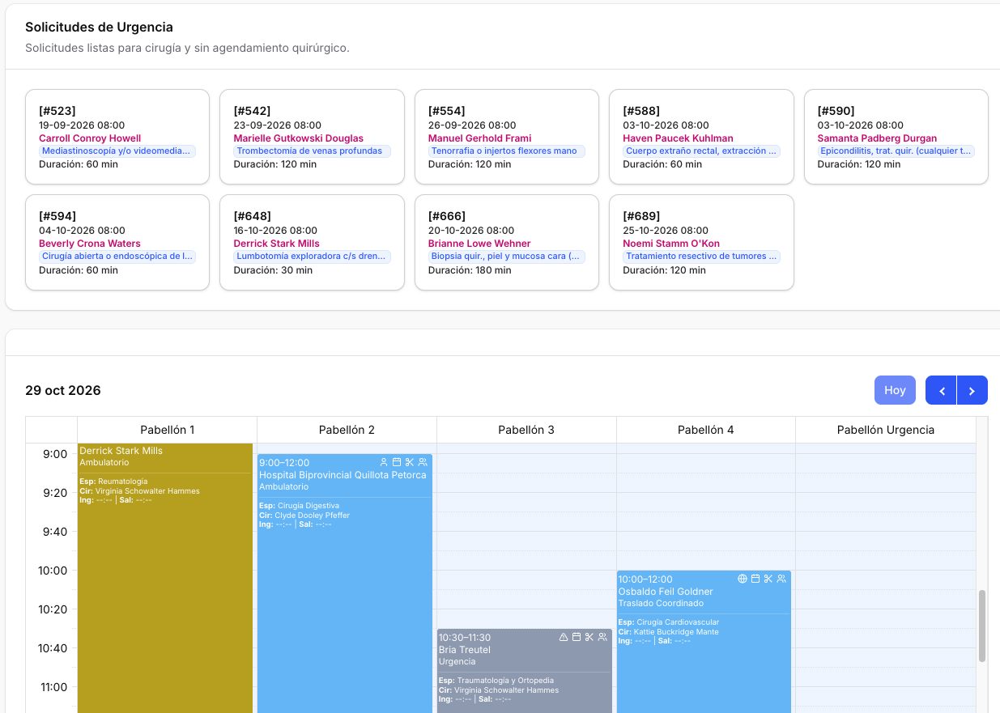

# Agenda Quirúrgica

## Descripción General
La Agenda Quirúrgica es el módulo central para la planificación y gestión de las cirugías programadas en el hospital.

## Funcionalidades Principales

En la parte superior se encuentran los siguientes botones:

- **Crear agendamiento quirúrgico**: Permite programar una cirugía de forma manual.
- **Solicitar planificación**: Permite definir el día, los pabellones y los criterios de selección de pacientes para que el motor proponga cirugías en espacios libres. Las propuestas no ocupan la agenda hasta ser aceptadas individualmente.
- **Gestionar planificación**: Permite revisar el avance del ciclo y las propuestas del motor, visibles achuradas en el calendario y en la bandeja. Al aceptar una propuesta se crea el agendamiento real; también se puede rechazar.
- **Imprimir**: Permite imprimir la agenda quirúrgica.

### Programar Cirugía
- Seleccionar paciente con evaluación prequirúrgica aprobada
- Definir tipo de cirugía y procedimiento
- Asignar quirófano y horario
- Designar equipo quirúrgico (cirujano, anestesiólogo, arsenalera, etc.)
- Estimar duración del procedimiento

### Visualización de Agenda
- Vista diaria por quirófano
- Vista semanal consolidada
- Código de colores por especialidad
- Indicadores de urgencia y prioridad
- Arrastrar Solicitudes de Urgencia al calendario.
- Listado al final de las agendas quirúrgicas según buscador

### Recursos Necesarios
- Material quirúrgico específico
- Equipamiento especial
- Banco de sangre
- Unidades de soporte (UCI, recuperación)

### Estados 
- Propuesto
- Pendiente
- Agendado
- Llegado
- Cumplido
- Cancelado
- No se presentó

### Modificar Programación
- Cambiar fecha u hora
- Reasignar quirófano
- Modificar equipo quirúrgico (participantes)
- Actualizar duración estimada

## Notificaciones
- Alertas automáticas al equipo quirúrgico
- Recordatorios de preparación
- Avisos de cambios en la programación

## Reportes
- Ocupación de quirófanos
- Cirugías por especialidad
- Tiempos quirúrgicos
- Indicadores de eficiencia
